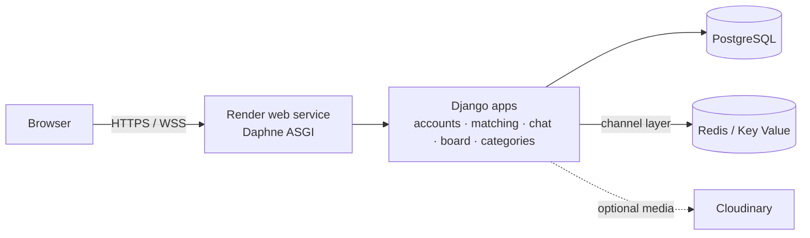

# M8Match

The website for you to find your mates and make the impossible things together!
CN331 Software Engineering, Thammasat University, 2026 academic year.

**Features:** register / profile, project & skill matching (swipe), real-time chat (WebSocket),
community board (posts, likes, comments, reports, moderation), categories.

## Architecture

Modular monolith: one Django project, one app per domain.



| App | Responsibility |
|---|---|
| `accounts` | register / login, profiles, shared navbar |
| `matching` | projects, swipes, matches (`services.py`) |
| `chat` | conversations, WebSocket consumer, image messages |
| `board` | posts, likes, comments, reports, moderation (adapter + services) |
| `categories` | skill / interest categories |

## Run locally

```bash
cd project
python -m venv .venv
.venv\Scripts\activate            # macOS/Linux: source .venv/bin/activate
pip install -r requirements-dev.txt
python manage.py migrate
python manage.py runserver
```

Local defaults: `DEBUG=True`, SQLite, in-memory chat layer. No `.env` needed.

### Tests, coverage, lint

```bash
cd project
coverage run manage.py test
coverage report            # must stay >= 80%
flake8 --config .flake8 .
```

The same checks run on every push / PR in GitHub Actions (`.github/workflows/ci.yml`).

## Deploy to Render

`render.yaml` creates everything: the web service (Daphne), PostgreSQL and Key Value (Redis).

1. Sign in to [render.com](https://render.com) with GitHub.
2. **New → Blueprint** → choose this repo → **Apply**.
3. Wait for the first build (`build.sh`: install → `collectstatic` → `migrate`).
4. Open `https://<service-name>.onrender.com`.

### Environment variables

| Variable | Required | Notes |
|---|---|---|
| `DJANGO_SECRET_KEY` | yes | Generated by Render (`generateValue`). Never commit it. |
| `DJANGO_DEBUG` | no | `False` on Render (default when `RENDER` is set). |
| `DATABASE_URL` | yes | From the Render PostgreSQL database. |
| `REDIS_URL` | yes for chat | From Render Key Value; real-time chat across processes. |
| `CLOUDINARY_URL` | no | Keeps uploaded images. Without it, uploads are lost on redeploy (free plan has no persistent disk). |
| `DJANGO_ALLOWED_HOSTS` | no | Extra hosts, comma-separated. The Render hostname is added automatically. |
| `DJANGO_CSRF_TRUSTED_ORIGINS` | no | Extra origins, e.g. `https://m8match.example.com`. |

### Check production settings locally

```bash
cd project
set DJANGO_DEBUG=False
set DJANGO_SECRET_KEY=any-long-random-string
python manage.py check --deploy
```

### Free plan notes

- The service sleeps when idle; the first request after that takes about a minute. Open the site before a demo.
- Create a superuser from the Render **Shell** tab: `python manage.py createsuperuser`.
